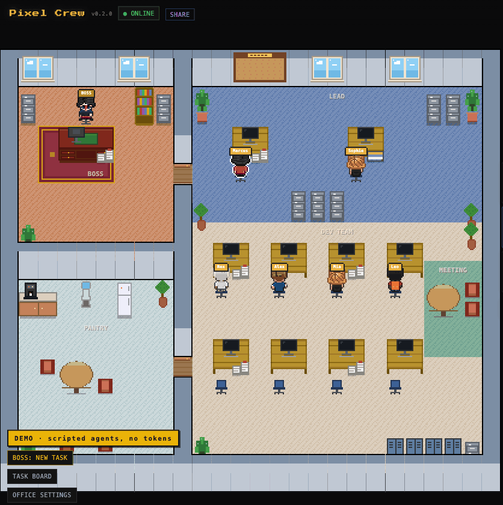
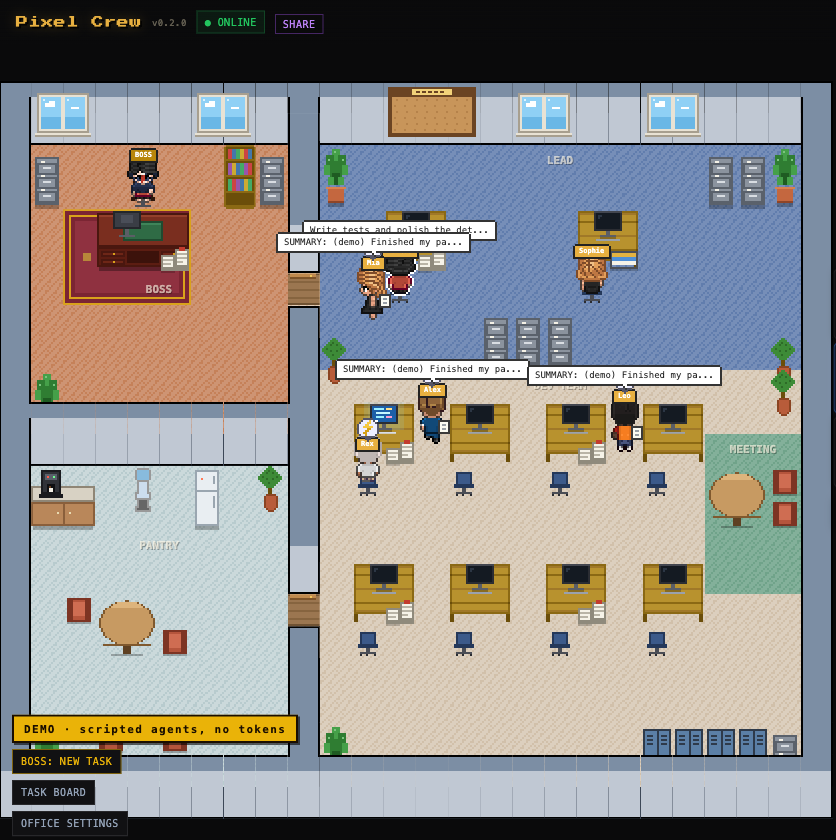
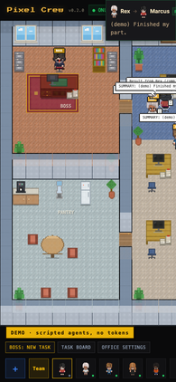
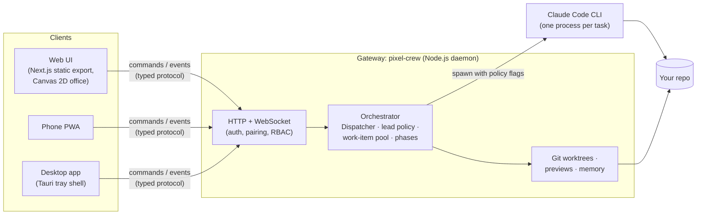

<div align="center">

# Pixel Crew

**A pixel-art mini company that runs your AI coding agents.**

You are the Boss. You hand a task to your Lead (Claude Code). The Lead splits it up and walks each part over to a developer who is free. When the work is done, the developers walk it back.

[](https://github.com/dathc0601/pixel-crew/actions/workflows/ci.yml)
[](LICENSE)
[](https://nodejs.org/)

English · [Tiếng Việt](README.vi.md)



<sub>Recorded in demo mode: every agent is scripted, nothing calls an AI, no tokens are spent.</sub>

</div>

---

- [What it is](#what-it-is)
- [Quick start](#quick-start): [demo](#1-try-the-demo-no-ai-cli-needed) · [with Claude Code](#2-run-it-with-claude-code)
- [Office settings](#office-settings)
- [Platforms](#platforms)
- [Security defaults](#security-defaults)
- [How it works](#how-it-works)
- [Extending](#extending) · [Contributing](#contributing) · [Roadmap](#roadmap) · [Credits](#credits)

## What it is

Pixel Crew is a small local server (the *gateway*) plus a web UI showing a pixel-art office. Inside the office:

- **The Boss (you)** sits in the corner office. Click the Boss, type what you want built, and hand it over.
- **The Lead** is a Claude Code session that plans the work and splits it into tasks. By default the Lead never writes code itself.
- **The developers** are Claude Code sessions too. The gateway's dispatcher gives each task to a developer who is idle. When everyone is busy, the tasks wait on the Lead's cork board.
- **The reviewer** checks what the developers delivered before the Lead reports back to you.

Every hand-off is a short walk across the office with a sheet of paper. The walk is cosmetic and the gateway owns the timing, so a phone, a second browser and the desktop app all show the same office.

| Desktop browser | Phone (PWA) |
|---|---|
|  |  |

What else is in the box:
- **Git worktree isolation.** Each agent works on its own branch, with auto-merge and undo.
- **Live previews** of what the team built, sandboxed on a separate port.
- **Persistent memory** across sessions, and token usage per agent.
- **Phone remote**: pair with a QR code, then assign tasks and approve permissions from your phone.
- **Lightweight**: the office draws nothing while nobody works, and the gateway stays around 80 MB of RAM.

## Quick start

You need **Node.js 22+** and **pnpm 9**. Pixel Crew is not on npm yet, so run it from source:

```bash
git clone https://github.com/dathc0601/pixel-crew.git
cd pixel-crew
pnpm install
```

### 1. Try the demo (no AI CLI needed)

```bash
pnpm demo
```

This builds the web UI the first time, starts the gateway with scripted fake agents and opens <http://localhost:9090>. It hires a Lead, four developers and a reviewer. Click **BOSS: NEW TASK**, type anything and press **Hand it to the Lead**.

Demo mode never starts an AI CLI and never spends tokens. It keeps its data in `~/.pixel-crew-demo/`, apart from a real office. Set `PIXEL_CREW_HOME` to put it somewhere else.

### 2. Run it with Claude Code

1. Install [Claude Code](https://docs.claude.com/en/docs/claude-code) and sign in once (`claude` in a terminal).
2. Start Pixel Crew:

   ```bash
   pnpm start          # builds the web UI, then starts the gateway on http://localhost:9090
   ```

   The first run asks a few setup questions in the terminal. `pnpm start -- --setup` asks them again.
3. In the browser, hire a team (**+**), choose the project folder (**New Project**), then click the Boss and hand over a task.

Agents work in the folder you pick for the project. The gateway's default folder is the directory it was started in; the `WORKSPACE=/path/to/repo` environment variable changes it.

**Desktop app**: unsigned installers for macOS, Windows and Linux are attached to each [release](https://github.com/dathc0601/pixel-crew/releases). See [docs/desktop.md](docs/desktop.md).

**For development**: `pnpm dev` (gateway on :9099 + web dev server with hot reload) or `pnpm dev:demo`.

## Office settings

Open **OFFICE SETTINGS** in the office (owner only). Every setting is also in `~/.pixel-crew/config.json`; the gateway reloads that file when it changes, so you never have to edit it by hand.

```json
{
  "office": {
    "permissionMode": "auto",
    "lead": { "selfWork": "never", "subagents": "when_all_devs_busy", "waitMs": 120000 },
    "handoff": { "durationMs": 2500 }
  }
}
```

| Setting | Values (default first) | What it does |
|---|---|---|
| `lead.selfWork` | `never` · `urgent_only` · `when_no_dev_after_wait` | Whether the Lead may do a task itself instead of delegating it. |
| `lead.subagents` | `when_all_devs_busy` · `never` · `urgent_only` · `allowed` | Whether the Lead may start Claude Code subagents. |
| `lead.waitMs` | `120000` | How long an urgent task waits for a free developer before the self-work rule applies. |
| `handoff.durationMs` | `2500` (0 to 10000) | How long each hand-off takes: about 1.9 s of walking plus 0.6 s handing the paper over. `0` is instant. Real work starts after the hand-off. |
| `permissionMode` | `auto` · `ask` | `auto` runs Claude Code with `--permission-mode auto`. `ask` makes you approve every agent run. |
| `backendPermissions` | `{}` | Per-backend override, e.g. `{"claude": "bypass"}`. Bypass is never a default. |

The Boss composer can narrow these rules for a single task, for example by forbidding subagents. The gateway enforces the policy with CLI flags, not prompts: a Lead that may not work gets no tools.

Other keys in `config.json`:
- `"lan": true`: let phones on your network pair (same as `--lan`).
- `"publicUrl"`: the HTTPS address in front of the gateway, e.g. Tailscale serve.
- `"externalAgents": false`: stop looking for Claude sessions you started yourself in a terminal.

The data folder is `~/.pixel-crew/` (`~/.pixel-crew-dev/` for `pnpm dev`). `PIXEL_CREW_HOME` overrides it.

## Platforms

| Platform | How | Status |
|---|---|---|
| macOS (Apple Silicon, Intel) | Browser, or the desktop app (`.dmg`) | Daily use; tested |
| Windows 10/11 | Browser, or the desktop app (NSIS `*-setup.exe`) | CI runs the full test suite; needs a real-machine smoke test |
| Linux | Browser, or the desktop app (`.deb`, `.AppImage`) | CI runs the full test suite |
| Phone (iOS, Android) | The web UI as a PWA, paired by QR code ([docs/mobile.md](docs/mobile.md)) | Tested in emulation; agents never run on the phone |

The desktop app is a thin tray shell around the same gateway. It uses the Node.js 22+ you already have, which keeps the installers at 5 to 9 MB. The builds are unsigned; [docs/desktop.md](docs/desktop.md) explains how to open them.

## Security defaults

Pixel Crew can run code on your machine, so the defaults are strict:

- The gateway listens on `127.0.0.1` only. LAN access needs `--lan`.
- Quick connect (`/connect`) answers only the browser on the same machine, from the UI's own origin. It refuses foreign origins and proxied requests.
- Phones pair with a one-time QR link (2 minutes, single use) or a pair code. Each device gets its own session, which expires and can be revoked from **Office settings → Paired devices**.
- Claude Code runs with `--permission-mode auto`. A backend without an auto mode asks you before every run. Bypass is a per-backend opt-in only.
- The gateway refuses to run as root unless you pass `--allow-root`.
- Previews run on a separate port inside a sandboxed iframe.
- **No telemetry.** Pixel Crew sends no analytics, crash reports or update checks. The UI loads no third-party scripts or fonts. The only outbound connections are the ones you configure: the AI CLIs themselves, and optionally Ably, Telegram or a Cloudflare tunnel.

Please report vulnerabilities privately. See [SECURITY.md](SECURITY.md), which also holds the threat model.

## How it works



- `apps/gateway`: the daemon and CLI (npm name `pixel-crew`). It serves the web UI and runs the agents.
- `packages/orchestrator`: agent sessions, the Dispatcher (`dispatcher.ts`), the lead policy (`lead-policy.ts`), worktrees and previews.
- `packages/shared`: the command and event protocol, as Zod schemas.
- `apps/web`: the office (Canvas 2D, no game engine), the Boss composer and the control panels.
- `apps/desktop`: the Tauri v2 tray app.

A task's lifecycle: `BOSS_ASSIGN` → the Lead plans and emits `TASK:` lines → the Dispatcher queues them and picks idle developers (`HANDOFF` events drive the walks) → developers report back → review → the result goes to the Boss. More detail: [team-workflow.md](team-workflow.md), [packages/orchestrator/README.md](packages/orchestrator/README.md), [packages/memory/README.md](packages/memory/README.md).

## Extending

- **Theme packs**: JSON palettes in `apps/web/public/themes/`.
- **Role packs**: Claude Code agent profiles in `packages/orchestrator/agents/`.
- **Scene adapters**: draw the office some other way.
- **New AI vendors**: the plan for multi-vendor support.

How-tos: [docs/extending.md](docs/extending.md) and [docs/adding-a-vendor.md](docs/adding-a-vendor.md).

## Contributing

Issues and pull requests are welcome. Start with [CONTRIBUTING.md](CONTRIBUTING.md), which covers the setup, the checks CI runs, the commit style and how releases work. Everyone taking part is expected to follow the [Code of Conduct](CODE_OF_CONDUCT.md).

## Roadmap

v1 (0.2.0) is the Boss → Lead → Dev office for **Claude Code**. Next:

1. **Multi-vendor support (Phase 2)**: an `AgentDriver` layer, with ACP (via [acpx](https://github.com/openclaw/acpx)) as the default for Codex, Gemini, Antigravity and others. It will also bring real permission requests from agents and status for Claude sessions you started yourself. The upstream code still has experimental adapters for Codex, Gemini, Copilot, Cursor, Aider, OpenCode, Pi and Sapling, but they are untested in Pixel Crew.
2. **A static web demo** on GitHub Pages that runs the scripted flow in the browser, with no install.
3. **Ambient office life** (coffee machine, day/night window light) that costs no CPU while idle.
4. **npm release**: `npx pixel-crew`.

The full plan is in [docs/plans/2026-11-07-fork-improvement-plan.md](docs/plans/2026-11-07-fork-improvement-plan.md).

## Credits

- Pixel Crew is a fork of [longyangxi/OpenOffice](https://github.com/longyangxi/OpenOffice) (formerly "bit-office") by Mark Long, MIT. The orchestrator, worktree isolation, memory and much of the UI come from there.
- The pixel office engine, the character and wall sprites and the original layout are derived from [pixel-agents](https://github.com/pablodelucca/pixel-agents) by Pablo De Lucca, MIT.
- The character sprites are based on JIK-A-4's [Metro City](https://jik-a-4.itch.io/metrocity-free-topdown-character-pack) pack, CC0.
- Fonts: [Press Start 2P](https://fonts.google.com/specimen/Press+Start+2P), [Inter](https://rsms.me/inter/) and [JetBrains Mono](https://www.jetbrains.com/lp/mono/), all under the SIL Open Font License, self-hosted.
- The multi-vendor plan builds on pixtuoid, [openclaw/acpx](https://github.com/openclaw/acpx), [Enderfga/claw-orchestrator](https://github.com/Enderfga/claw-orchestrator) and [oxgeneral/ORCH](https://github.com/oxgeneral/ORCH). See [docs/adding-a-vendor.md](docs/adding-a-vendor.md).

The full license texts, and the assets that are deliberately not shipped, are in [THIRD_PARTY_NOTICES.md](THIRD_PARTY_NOTICES.md).

## License

[MIT](LICENSE)
