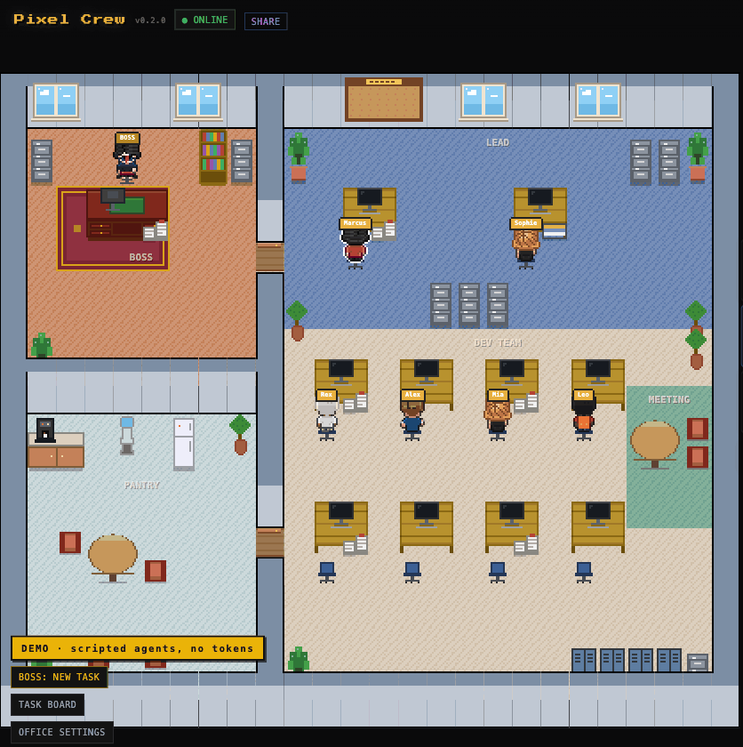
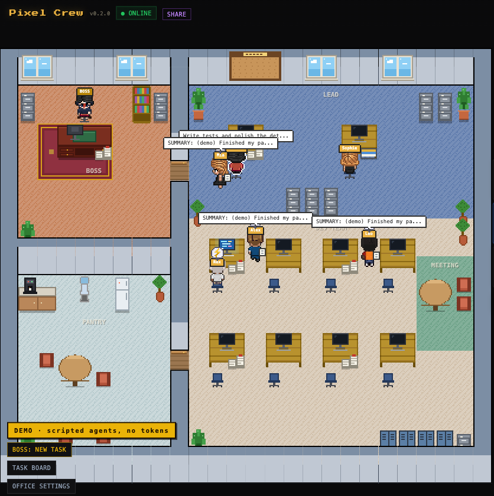
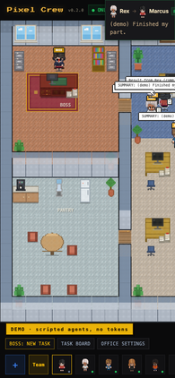
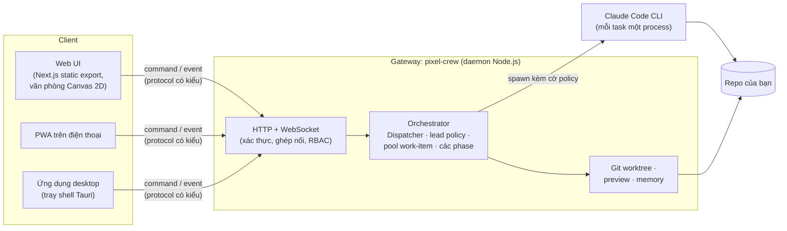

<div align="center">

# Pixel Crew

**Một công ty mini phong cách pixel-art, nơi các AI coding agent làm việc cho bạn.**

Bạn là Boss. Bạn giao task cho Lead (Claude Code). Lead chia nhỏ task rồi mang từng phần sang cho developer nào đang rảnh. Làm xong, các developer lại mang kết quả về.

[](https://github.com/dathc0601/pixel-crew/actions/workflows/ci.yml)
[](LICENSE)
[](https://nodejs.org/)

[English](README.md) · Tiếng Việt



<sub>Quay ở chế độ demo: mọi agent đều chạy theo kịch bản, không gọi AI nào, không tốn token nào.</sub>

</div>

---

- [Pixel Crew là gì](#pixel-crew-là-gì)
- [Bắt đầu nhanh](#bắt-đầu-nhanh): [demo](#1-chạy-thử-bản-demo-không-cần-ai-cli) · [với Claude Code](#2-chạy-với-claude-code)
- [Cài đặt văn phòng](#cài-đặt-văn-phòng)
- [Nền tảng hỗ trợ](#nền-tảng-hỗ-trợ)
- [Bảo mật mặc định](#bảo-mật-mặc-định)
- [Cách hoạt động](#cách-hoạt-động)
- [Mở rộng](#mở-rộng) · [Đóng góp](#đóng-góp) · [Lộ trình](#lộ-trình) · [Ghi công](#ghi-công)

## Pixel Crew là gì

Pixel Crew gồm một server nhỏ chạy trên máy bạn (gọi là *gateway*) và một web UI hiển thị một văn phòng pixel-art. Trong văn phòng có:

- **Boss (sếp, chính là bạn)** ngồi ở phòng riêng trong góc. Bấm vào Boss, gõ thứ bạn muốn làm rồi giao đi.
- **Lead (trưởng nhóm)** là một phiên Claude Code, chuyên lên kế hoạch và chia việc thành các task. Mặc định Lead không bao giờ tự tay viết code.
- **Các developer** cũng là các phiên Claude Code. Dispatcher của gateway giao mỗi task cho một developer đang rảnh. Khi ai cũng bận, task sẽ nằm chờ trên bảng ghim của Lead.
- **Reviewer** kiểm tra những gì developer bàn giao trước khi Lead báo cáo lại cho bạn.

Mỗi lần bàn giao là một lần nhân vật cầm tờ giấy đi bộ một đoạn ngắn qua văn phòng. Đoạn đi bộ chỉ để trang trí, còn thời gian do gateway quyết định, nên điện thoại, một trình duyệt khác hay ứng dụng desktop đều thấy cùng một văn phòng.

| Trình duyệt desktop | Điện thoại (PWA) |
|---|---|
|  |  |

Ngoài ra còn có:
- **Cô lập bằng Git worktree.** Mỗi agent làm việc trên branch riêng, có auto-merge và undo.
- **Live preview** những gì team đã làm, chạy sandbox trên một port riêng.
- **Bộ nhớ lâu dài** giữa các phiên, kèm thống kê token theo từng agent.
- **Điều khiển từ điện thoại**: ghép nối bằng mã QR, sau đó giao task và duyệt quyền ngay trên điện thoại.
- **Nhẹ**: văn phòng không vẽ gì khi không ai làm việc, gateway chỉ tốn khoảng 80 MB RAM.

## Bắt đầu nhanh

Bạn cần **Node.js 22+** và **pnpm 9**. Pixel Crew chưa lên npm, nên hãy chạy từ source:

```bash
git clone https://github.com/dathc0601/pixel-crew.git
cd pixel-crew
pnpm install
```

### 1. Chạy thử bản demo (không cần AI CLI)

```bash
pnpm demo
```

Lần đầu chạy, lệnh này sẽ build web UI, khởi động gateway với các agent giả chạy theo kịch bản và mở <http://localhost:9090>. Nó sẽ tuyển một Lead, bốn developer và một reviewer. Bấm **BOSS: NEW TASK**, gõ gì cũng được rồi nhấn **Hand it to the Lead**.

Chế độ demo không bao giờ khởi động AI CLI và không bao giờ tốn token. Dữ liệu của nó nằm ở `~/.pixel-crew-demo/`, tách biệt với văn phòng thật. Đặt `PIXEL_CREW_HOME` nếu muốn lưu ở chỗ khác.

### 2. Chạy với Claude Code

1. Cài [Claude Code](https://docs.claude.com/en/docs/claude-code) và đăng nhập một lần (gõ `claude` trong terminal).
2. Khởi động Pixel Crew:

   ```bash
   pnpm start          # builds the web UI, then starts the gateway on http://localhost:9090
   ```

   Lần chạy đầu tiên sẽ hỏi vài câu thiết lập trong terminal. `pnpm start -- --setup` sẽ hỏi lại từ đầu.
3. Trên trình duyệt, tuyển một team (**+**), chọn thư mục project (**New Project**), rồi bấm vào Boss và giao task.

Các agent làm việc trong thư mục bạn chọn cho project. Thư mục mặc định của gateway là thư mục nơi bạn khởi động nó; biến môi trường `WORKSPACE=/path/to/repo` dùng để đổi thư mục này.

**Lệnh `pixel-crew` khi chạy từ source.** Pixel Crew chưa lên npm, nên lệnh `pixel-crew` chưa có trong `PATH`. Lệnh này cần cho `pixel-crew claude-attachable`, xem [docs/attach-sessions.md](docs/attach-sessions.md). Sau khi `pnpm start` đã build gateway ít nhất một lần, bạn có hai cách:
- chạy `node apps/gateway/dist/index.js <lệnh con>` ngay trong thư mục repo;
- hoặc link file đã build vào một thư mục có trong `PATH`, ví dụ trên macOS/Linux: `ln -s "$PWD/apps/gateway/dist/index.js" "$(npm prefix -g)/bin/pixel-crew"`.

**Ứng dụng desktop**: bộ cài chưa ký cho macOS, Windows và Linux được đính kèm trong mỗi [release](https://github.com/dathc0601/pixel-crew/releases). Xem [docs/desktop.md](docs/desktop.md).

**Để phát triển**: `pnpm dev` (gateway ở :9099 + web dev server có hot reload) hoặc `pnpm dev:demo`.

## Cài đặt văn phòng

Mở **OFFICE SETTINGS** trong văn phòng (chỉ owner mới mở được). Mọi thiết lập cũng nằm trong `~/.pixel-crew/config.json`; gateway tự nạp lại file này mỗi khi nó thay đổi, nên bạn không bao giờ phải sửa tay.

```json
{
  "office": {
    "permissionMode": "auto",
    "lead": { "selfWork": "never", "subagents": "when_all_devs_busy", "waitMs": 120000 },
    "handoff": { "durationMs": 2500 }
  }
}
```

| Thiết lập | Giá trị (mặc định đứng đầu) | Tác dụng |
|---|---|---|
| `lead.selfWork` | `never` · `urgent_only` · `when_no_dev_after_wait` | Lead có được tự làm task thay vì giao cho người khác hay không. |
| `lead.subagents` | `when_all_devs_busy` · `never` · `urgent_only` · `allowed` | Lead có được khởi động subagent của Claude Code hay không. |
| `lead.waitMs` | `120000` | Task gấp sẽ chờ developer rảnh trong bao lâu trước khi áp dụng quy tắc tự làm. |
| `handoff.durationMs` | `2500` (0 đến 10000) | Mỗi lần bàn giao mất bao lâu: khoảng 1,9 giây đi bộ cộng 0,6 giây đưa giấy. `0` là tức thì. Việc thật chỉ bắt đầu sau khi bàn giao xong. |
| `permissionMode` | `auto` · `ask` | `auto` chạy Claude Code với `--permission-mode auto`. `ask` bắt bạn duyệt mỗi lần agent chạy. |
| `backendPermissions` | `{}` | Ghi đè theo từng backend, ví dụ `{"claude": "bypass"}`. Bypass không bao giờ là mặc định. |

Ô soạn task của Boss có thể siết các quy tắc này lại cho riêng một task, ví dụ cấm dùng subagent. Gateway áp policy bằng cờ CLI chứ không phải bằng prompt: Lead nào không được phép làm việc thì không được cấp tool nào.

Các key khác trong `config.json`:
- `"lan": true`: cho phép điện thoại trong cùng mạng ghép nối (giống `--lan`).
- `"publicUrl"`: địa chỉ HTTPS đứng trước gateway, ví dụ Tailscale serve.
- `"externalAgents": false`: ngừng dò tìm các phiên Claude mà bạn tự mở trong terminal.

Các phiên Claude bạn tự mở hiện ra trong văn phòng dưới dạng nhân vật bên ngoài. Bấm vào một nhân vật rồi chọn **Join team** để biến nó thành developer mà Lead có thể giao task: việc chạy trong một bản fork của phiên đó (terminal của bạn không bị đụng tới), hoặc chạy trực tiếp trong terminal đó. Xem [docs/attach-sessions.md](docs/attach-sessions.md).

Thư mục dữ liệu là `~/.pixel-crew/` (`~/.pixel-crew-dev/` khi chạy `pnpm dev`). `PIXEL_CREW_HOME` sẽ ghi đè đường dẫn này.

## Nền tảng hỗ trợ

| Nền tảng | Cách dùng | Trạng thái |
|---|---|---|
| macOS (Apple Silicon, Intel) | Trình duyệt, hoặc ứng dụng desktop (`.dmg`) | Dùng hằng ngày; đã test |
| Windows 10/11 | Trình duyệt, hoặc ứng dụng desktop (NSIS `*-setup.exe`) | CI chạy toàn bộ test suite; cần smoke test trên máy thật |
| Linux | Trình duyệt, hoặc ứng dụng desktop (`.deb`, `.AppImage`) | CI chạy toàn bộ test suite |
| Điện thoại (iOS, Android) | Web UI dưới dạng PWA, ghép nối bằng mã QR ([docs/mobile.md](docs/mobile.md)) | Đã test trên giả lập; agent không bao giờ chạy trên điện thoại |

Ứng dụng desktop chỉ là một lớp vỏ tray mỏng bọc quanh chính gateway đó. Nó dùng Node.js 22+ có sẵn trên máy bạn, nhờ vậy bộ cài chỉ nặng 5 đến 9 MB. Các bản build chưa được ký; [docs/desktop.md](docs/desktop.md) hướng dẫn cách mở chúng.

## Bảo mật mặc định

Pixel Crew có thể chạy code trên máy bạn, nên các thiết lập mặc định rất chặt:

- Gateway chỉ lắng nghe trên `127.0.0.1`. Muốn truy cập qua LAN thì cần `--lan`.
- Kết nối nhanh (`/connect`) chỉ trả lời trình duyệt trên cùng máy, từ đúng origin của UI. Nó từ chối origin lạ và request đi qua proxy.
- Điện thoại ghép nối bằng link QR dùng một lần (hiệu lực 2 phút, chỉ dùng được một lần) hoặc mã ghép nối. Mỗi thiết bị có session riêng, session này sẽ hết hạn và có thể thu hồi trong **Office settings → Paired devices**.
- Claude Code chạy với `--permission-mode auto`. Backend nào không có chế độ auto sẽ hỏi bạn trước mỗi lần chạy. Bypass chỉ bật khi bạn chủ động chọn cho từng backend.
- Gateway từ chối chạy dưới quyền root, trừ khi bạn truyền `--allow-root`.
- Preview chạy trên port riêng, bên trong một iframe sandbox.
- **Không telemetry.** Pixel Crew không gửi analytics, báo cáo crash hay kiểm tra cập nhật. UI không tải script hay font nào của bên thứ ba. Kết nối ra ngoài chỉ có những gì bạn tự cấu hình: bản thân các AI CLI, và tùy chọn thêm Ably, Telegram hoặc Cloudflare tunnel.

Vui lòng báo cáo lỗ hổng bảo mật một cách riêng tư. Xem [SECURITY.md](SECURITY.md), trong đó có cả threat model.

## Cách hoạt động



- `apps/gateway`: daemon và CLI (tên trên npm là `pixel-crew`). Nó phục vụ web UI và chạy các agent.
- `packages/orchestrator`: các phiên agent, Dispatcher (`dispatcher.ts`), lead policy (`lead-policy.ts`), worktree và preview.
- `packages/shared`: protocol cho command và event, viết bằng Zod schema.
- `apps/web`: văn phòng (Canvas 2D, không dùng game engine), ô soạn task của Boss và các bảng điều khiển.
- `apps/desktop`: ứng dụng tray viết bằng Tauri v2.

Vòng đời của một task: `BOSS_ASSIGN` → Lead lên kế hoạch và xuất ra các dòng `TASK:` → Dispatcher đưa chúng vào hàng đợi và chọn developer đang rảnh (event `HANDOFF` điều khiển các đoạn đi bộ) → developer báo cáo lại → review → kết quả được gửi về cho Boss. Chi tiết hơn: [team-workflow.md](team-workflow.md), [packages/orchestrator/README.md](packages/orchestrator/README.md), [packages/memory/README.md](packages/memory/README.md).

## Mở rộng

- **Theme pack**: các bảng màu JSON trong `apps/web/public/themes/`.
- **Role pack**: profile agent của Claude Code trong `packages/orchestrator/agents/`.
- **Scene adapter**: vẽ văn phòng theo cách khác.
- **Nhà cung cấp AI mới**: kế hoạch hỗ trợ nhiều nhà cung cấp.

Hướng dẫn: [docs/extending.md](docs/extending.md) và [docs/adding-a-vendor.md](docs/adding-a-vendor.md).

## Đóng góp

Mọi issue và pull request đều được hoan nghênh. Hãy bắt đầu với [CONTRIBUTING.md](CONTRIBUTING.md), trong đó có hướng dẫn thiết lập, các bước kiểm tra mà CI chạy, quy ước commit và cách phát hành. Mọi người tham gia đều cần tuân thủ [Code of Conduct](CODE_OF_CONDUCT.md).

## Lộ trình

v1 (0.2.0) là văn phòng Boss → Lead → Dev dành cho **Claude Code**. Tiếp theo:

1. **Hỗ trợ nhiều nhà cung cấp (Phase 2)**: một lớp `AgentDriver`, với ACP (qua [acpx](https://github.com/openclaw/acpx)) làm mặc định cho Codex, Gemini, Antigravity và các tool khác. Bản này cũng sẽ mang lại yêu cầu cấp quyền thật từ agent. Việc gắn các phiên Claude bạn tự mở vào team (Phase 2a) đã có sẵn. Code upstream vẫn còn các adapter thử nghiệm cho Codex, Gemini, Copilot, Cursor, Aider, OpenCode, Pi và Sapling, nhưng chưa được test trong Pixel Crew.
2. **Bản web demo tĩnh** trên GitHub Pages, chạy luồng kịch bản ngay trên trình duyệt, không cần cài đặt.
3. **Không khí văn phòng sống động** (máy pha cà phê, ánh sáng cửa sổ theo ngày/đêm) mà không tốn CPU khi rảnh.
4. **Phát hành lên npm**: `npx pixel-crew`.

Kế hoạch đầy đủ nằm ở [docs/plans/2026-11-07-fork-improvement-plan.md](docs/plans/2026-11-07-fork-improvement-plan.md).

## Ghi công

- Pixel Crew là bản fork của [longyangxi/OpenOffice](https://github.com/longyangxi/OpenOffice) (trước đây là "bit-office") của Mark Long, giấy phép MIT. Orchestrator, cơ chế cô lập worktree, memory và phần lớn UI đều đến từ đó.
- Engine văn phòng pixel, sprite nhân vật và tường cùng layout gốc được phát triển dựa trên [pixel-agents](https://github.com/pablodelucca/pixel-agents) của Pablo De Lucca, giấy phép MIT.
- Sprite nhân vật dựa trên bộ [Metro City](https://jik-a-4.itch.io/metrocity-free-topdown-character-pack) của JIK-A-4, giấy phép CC0.
- Font: [Press Start 2P](https://fonts.google.com/specimen/Press+Start+2P), [Inter](https://rsms.me/inter/) và [JetBrains Mono](https://www.jetbrains.com/lp/mono/), tất cả theo SIL Open Font License, được tự host.
- Kế hoạch hỗ trợ nhiều nhà cung cấp dựa trên pixtuoid, [openclaw/acpx](https://github.com/openclaw/acpx), [Enderfga/claw-orchestrator](https://github.com/Enderfga/claw-orchestrator) và [oxgeneral/ORCH](https://github.com/oxgeneral/ORCH). Xem [docs/adding-a-vendor.md](docs/adding-a-vendor.md).

Toàn văn các giấy phép, cùng danh sách những asset được cố ý không đưa vào bản phát hành, nằm trong [THIRD_PARTY_NOTICES.md](THIRD_PARTY_NOTICES.md).

## Giấy phép

[MIT](LICENSE)
